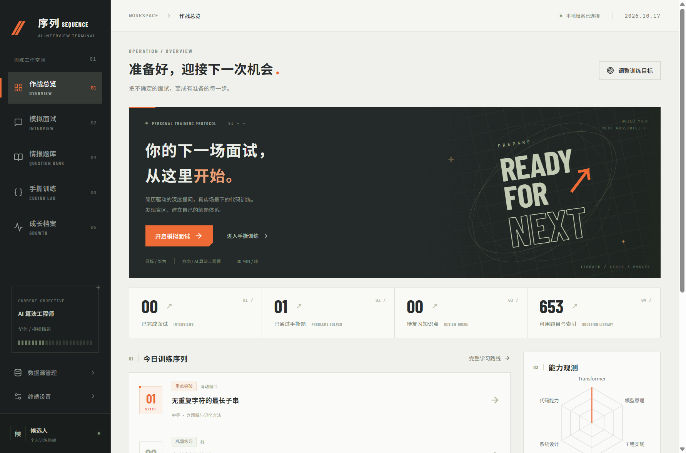
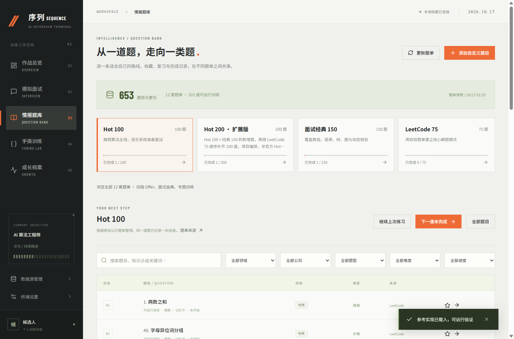

# 序列 · Sequence

本地优先的 AI 面试训练工具。Windows 桌面端与 Android APK 共用题库和练习逻辑，模型 API 由用户自行配置。

[下载安装包](https://github.com/jianghaisi/AImainsi/releases/tag/v0.2.0-preview) · [源码仓库](https://github.com/jianghaisi/AImainsi) · [问题反馈](https://github.com/jianghaisi/AImainsi/issues)





## 当前版本：0.2.0 预览

- 简历文本、PDF、DOCX 导入；根据简历、目标岗位、公司风格进行面试与追问。
- 自定义公司画像、提示词、轮数、时长、学习时间、主题色；中文或英文面试。
- Python、JavaScript、Java、C++ 题目模板与题解。Python / JavaScript 在设备的 Web Worker 中运行测试，Python 运行时随应用打包，无需安装 Python。
- 手撕计时、草稿、逐例结果、原理记忆卡、间隔复习、薄弱点与学习计划。
- 12 套常用题单、去重后 647 道题：Hot 100、Hot 200 扩展版、经典 150、LeetCode 75、原剑指 Offer、面试金典、动态规划、二分与图论等。Hot 200 是项目编排，非官方排名。
- Hot 200 全部可做本地训练，含原创思路与记忆卡、Python 参考实现；146 道还有已验证的 JavaScript 参考实现。加上原有独立训练，共 203 道可运行题。其他题目提供原题索引和学习记录。测试是示例训练，不等同于原站完整判题。
- 题单共享进度、收藏、个人笔记、未完成筛选、分页、继续上次练习；手动完成与测试通过分别显示。题单可检查更新，保留旧草稿与训练记录。[完整覆盖与维护说明](docs/question-bank.md)。
- 面经 JSON 导入、去重与审核；Spider_XHS 可选采集桥接脚本。
- Chat Completions 兼容模型 API、自定义判题 API、连接测试、无密钥档案导出。
- Windows SQLite 与 Android IndexedDB 保存个人数据；桌面系统加密和 Android Keystore 保存 API 密钥。

没有配置模型时，可以使用题库、手撕训练和本地结构提示；本地提示不冒充 AI 专业评分。公司画像展示来源，预设风格不代表企业官方标准。

## 安装预览版

构建产物放在 `release/`：

- Windows x64：解压 `Sequence-0.2.0-Windows-x64.zip` 到独立目录，运行其中的 `Sequence.exe`。需保留同目录的资源和 DLL，不能只复制 EXE。
- Android 8.0+：安装 `Sequence-0.2.0-Android-preview.apk`。这是使用调试证书签名的开发预览包，未上架应用商店，后续正式签名版本可能需要先卸载预览版。卸载前导出档案。

首次启动进入「系统设置」，填写自己的 API 基础地址、模型名和密钥，保存后测试连接。例如兼容服务的基础地址可填写 `https://your-provider.example/v1`，应用调用其 `/chat/completions`。这里的示例不是可用服务。无须填写项目维护者的密钥，也无内置付费 API。

手机与桌面都能离线执行 Python 标准库、JavaScript 的内置题目；Java / C++ 的真实编译执行需要自配判题服务。模型评分、题库更新需要网络。界面当前为中文，面试问答可选择中文或英文。

## 源码运行

要求 Node.js 24，建议使用 npm 锁文件安装。依赖安装会复制 Python WASM 与 PDF 解析运行时到本地资源目录。

```sh
npm ci
npm run dev
```

浏览器访问 `http://127.0.0.1:4178`。开发服务仅监听本机，默认数据在 `.data/`，可通过 `PORT` 和 `DATA_DIR` 覆盖。`.data/`、密钥、采集资料、构建工具和安装包均被 Git 忽略。

```sh
npm run build
npm run desktop
npm run desktop:build
```

Windows 打包命令生成 ZIP 版桌面应用。开发网页模式的 API 密钥保存在本地 SQLite 中，**没有桌面系统加密**；使用个人密钥时优先运行桌面应用。

Android 构建要求 JDK 21、Android SDK platform 36、build-tools 36.0.0，并设置 `JAVA_HOME` 和 `ANDROID_HOME`。Gradle 会按插件要求补齐所需构建工具。

```sh
npm run android:build
```

在 Linux / macOS 首次构建前执行 `chmod +x android/gradlew`。脚本也支持本地 `.tools/java21/jdk-*` 与 `.tools/android-sdk`，这些工具不会随源代码分发。首轮构建需要联网下载依赖。

## 题库更新与面经

在「情报题库」点击「更新题单」，获取项目 main 分支已发布的公开题单元数据快照；新的可执行题目资源需要应用更新。维护者可运行 `python scripts/update-catalog.py` 从原站刷新快照，审核后发布。更新失败保留当前题库。

Zero2Leetcode 面经索引在「数据源管理」中同步；在设置中开启自动更新并选择间隔。Windows 应用运行期间定时检查，Android 在前台读取状态时检查，不承诺系统后台常驻或实时推送。同步记录保留来源与时间，重复项按来源去重。

Zero2Leetcode 原始来源：[华为面试资料](https://onefly.top/zero2Leetcode/05_interview/coding/huawei/)。内置手撕解释与测试由本项目编写；外部内容的权利不因项目开源而改变。

Spider_XHS 为可选外部项目，按其 [README](https://github.com/cv-cat/Spider_XHS) 独立安装。当前上游限制学习交流用途，禁止商业使用；本项目不捆绑该代码或采集数据。将自己的有效登录状态设置在 `XHS_COOKIE` 环境变量后运行：

```sh
python scripts/collect_xhs.py --repo /path/to/Spider_XHS --query "华为 AI 算法 面经" --company "华为" --output .data/xhs-notes.json
```

将输出 JSON 导入题库并审核。可加 `--interval-hours 24` 周期采集；开发网页服务运行时可加 `--ingest-url http://127.0.0.1:4178` 直接进入待审核列表。桥接器没有附带登录信息，未使用真实账号进行端到端采集验证。

## 验证

```sh
npm test
npx playwright install chromium
npm run test:e2e
npm run test:local
node scripts/smoke-desktop.mjs
```

Java / C++ 参考实现测试需本机 `javac`、`java`、`g++`，缺失会报告跳过。浏览器测试覆盖本地问答、代码执行、持久化、审核以及无后端的移动端存储逻辑。APK 编译通过不等于 Android 真机兼容性全部验证。

## 开源与后续

原创应用代码采用 [MIT](LICENSE)。第三方材料与依赖见 [NOTICE](NOTICE.md)。[API 协议](docs/api.md)、[架构与路线](docs/roadmap.md)、[隐私与安全](SECURITY.md)、[贡献指南](CONTRIBUTING.md)。

当前无账号系统、托管判题服务器或自动多端同步；导出用于归档，尚无完整档案恢复功能。未来可以逐步加入自托管判题、可选同步服务、网页客户端与加密同步，保留本地使用和自配 API 的能力。
